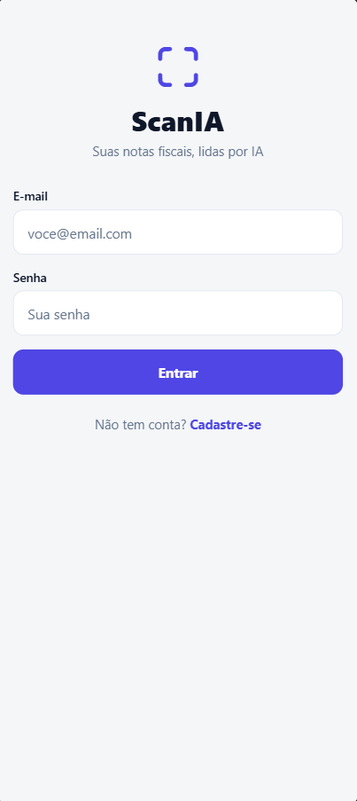
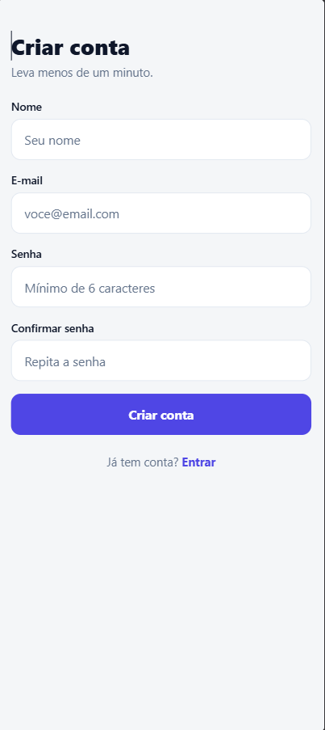
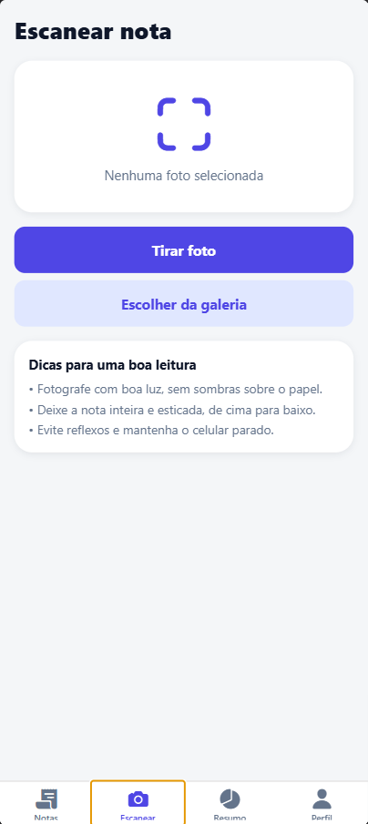

# ScanIA

Aplicativo mobile para digitalização e gestão de notas fiscais com inteligência artificial. O sistema realiza a leitura de cupons fiscais via visão computacional, extraindo automaticamente estabelecimento, data, valor total, categoria de despesa e itens da compra, permitindo conferência e edição pelo usuário e consolidação em resumos financeiros mensais.

## Funcionalidades

- **Autenticação e sessão persistente**: Cadastro, login seguro com JWT e restauração automática de sessão via armazenamento local seguro.
- **Captura e otimização de imagem**: Suporte a câmera e galeria com pré-visualização, redução proporcional para até 1600 px de largura e compressão JPEG a 70% antes do upload.
- **Extração com visão computacional**: Processamento de notas fiscais através do modelo Claude Vision da Anthropic ou Modo Simulado (com latência realista). A chave privada da IA fica isolada no backend.
- **Conferência e revisão de dados**: Interface para edição manual de valores, datas, nomes de estabelecimentos e seleção de categorias com validação de esquema via Zod.
- **Métricas e resumos financeiros**: Gráfico de rosca vetorial (`react-native-svg`), consolidação de gastos mensais, ticket médio e distribuição percentual por categoria.
- **Armazenamento privado**: Fotos salvas em bucket isolado por usuário com acesso restrito via links assinados temporários.
- **Backend local autônomo**: Arquitetura em Docker Compose com PostgreSQL e API em Node.js/TypeScript, operando sem dependências de serviços externos.

## Tecnologias

- **Mobile**: React Native, Expo, Expo Router, TypeScript, TanStack Query, React Hook Form, Zod, React Native SVG
- **Backend Local**: Node.js, Express, TypeScript, PostgreSQL 16, Docker Compose, JWT, Bcrypt
- **Inteligência Artificial**: Anthropic Claude API (tool use com saída estruturada) e Modo Simulado
- **Testes e Qualidade**: Jest (36 testes unitários para regras de negócio e validações), Prettier, ESLint, GitHub Actions (CI/CD)

## Capturas de tela

| Login | Cadastro |
| --- | --- |
|  |  |

| Notas | Escanear | Detalhes | Resumo |
| --- | --- | --- | --- |
|  |  |  |  |

## Arquitetura

```
ScanIa/
├── app/                        # Rotas e telas (Expo Router)
│   ├── _layout.tsx             # Provedores globais
│   ├── (auth)/                 # Rotas públicas (login, cadastro)
│   └── (app)/                  # Rotas protegidas (abas e detalhes)
├── src/
│   ├── components/             # Design System (Button, Input, DonutChart, ReceiptCard...)
│   ├── constants/              # Categorias, cores e ícones
│   ├── context/                # Contexto de autenticação
│   ├── hooks/                  # TanStack Query hooks (useReceipts, useScanReceipt...)
│   ├── lib/                    # Configurações do cliente Supabase e QueryClient
│   ├── schemas/                # Validações Zod (auth, receipt)
│   ├── services/               # Serviços de API, storage e câmera
│   ├── theme/                  # Tokens visuais (cores, espaçamentos, raios)
│   ├── types/                  # Tipagem de domínio
│   └── utils/                  # Funções puras (cálculo de dinheiro, datas, resumos)
├── server/                     # Backend local autônomo (substitui Supabase Cloud)
│   ├── docker-compose.yml      # Orquestração do Postgres e da API
│   ├── Dockerfile              # Imagem do servidor
│   ├── init.sql                # Script de inicialização do banco Postgres
│   ├── package.json            # Dependências do servidor
│   └── src/                    # Endpoints de Auth, REST, Storage e Invocação de IA
├── supabase/
│   ├── schema.sql              # Esquema SQL original de referência (RLS e tabelas)
│   └── functions/scan-receipt/ # Edge Function canônica (Deno)
├── relatorio/
│   └── relatorio.md            # Relatório técnico com problemas e soluções por etapa
└── __tests__/                  # 36 testes automatizados (Jest)
```

## Como Executar

### 1. Iniciar o Backend Local

Na pasta `server/`:

```bash
# Opção A: Executar com Docker Compose
docker compose -f server/docker-compose.yml up -d --build

# Opção B: Executar diretamente com Node.js
cd server
pnpm install
pnpm run dev
```

O servidor inicializará na porta `3000` (`http://localhost:3000`), pronto para responder às requisições de autenticação, banco de dados e upload.

### 2. Configurar Variáveis de Ambiente

Na raiz do projeto mobile:

```bash
cp .env.example .env
```

Configuração padrão de conexão local:
```env
EXPO_PUBLIC_SUPABASE_URL=http://localhost:3000
EXPO_PUBLIC_SUPABASE_KEY=eyJhbGciOiJIUzI1NiIsInR5cCI6IkpXVCJ9.e30.local-key
```

### 3. Instalar Dependências e Executar o App Mobile

Na raiz do projeto:

```bash
pnpm install
pnpm start
```

Pressione `a` para executar no emulador Android, `w` para versão Web, ou escaneie o QR Code no aplicativo **Expo Go** em seu dispositivo móvel conectado à mesma rede local.

### 4. Alternar para a API Real da Anthropic (Opcional)

Por padrão, o servidor executa com `MOCK_AI=true`. Para processar imagens reais com Claude Vision:

1. Configure sua chave privada no arquivo `server/.env`:
   ```env
   ANTHROPIC_API_KEY=sk-ant-api03-...
   MOCK_AI=false
   ```
2. Reinicie o servidor backend.

## Scripts Disponíveis

| Comando | Descrição |
| --- | --- |
| `pnpm start` | Inicia o servidor de desenvolvimento do Expo / Metro Bundler |
| `pnpm test` | Executa os 36 testes automatizados com Jest |
| `pnpm run typecheck` | Executa a validação estática de tipos com TypeScript |
| `pnpm run format` | Aplica a formatação em todos os arquivos com Prettier |

## Integração Contínua (CI/CD)

O repositório possui uma pipeline de integração contínua configurada no GitHub Actions (`.github/workflows/ci.yml`), acionada a cada `push` e `pull_request` na branch `main`:

- **Typecheck**: Validação estática de tipos (`tsc --noEmit`).
- **Testes Unitários**: Execução dos 36 testes automatizados no Jest.
- **Formatação**: Conferência de estilo de código com Prettier.
- **Deno Check**: Validação de tipos da Edge Function em ambiente Deno (`deno check`).
- **Build do Backend**: Compilação TypeScript do servidor Express em `server/`.

## Autor

João Augusto Neto - [GitHub](https://github.com/joaoaugustoneto)
