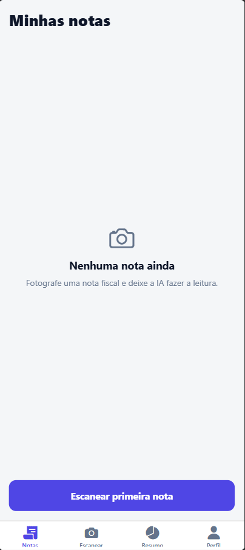
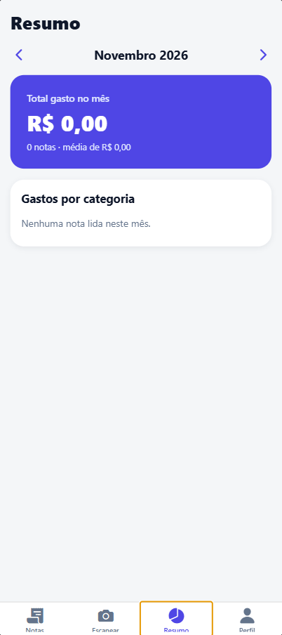

# ScanIA

Aplicativo mobile que lê notas fiscais com inteligência artificial: fotografe o
cupom, e o app extrai estabelecimento, data, valor, categoria e itens. Você revisa,
corrige e acompanha seus gastos por categoria.

## Funcionalidades

- **Cadastro, login e sessão persistente**: Autenticação com JWT e persistência local segura.
- **Captura por câmera ou galeria**: Pré-visualização com redução inteligente da imagem antes do envio (máx. 1600 px de largura e compressão JPEG).
- **Leitura da nota por IA**: Serviço no backend processa a imagem com modelo de visão (Claude Vision API ou Modo Simulado com latência realista) - a chave da IA nunca vai para o app.
- **Revisão e correção humana**: O usuário confere e edita qualquer informação sugerida pela IA antes de salvar.
- **Resumo mensal com gráficos**: Visualização com gráfico de rosca interativo (`react-native-svg`), totais acumulados, média de gastos e distribuição percentual por categorias.
- **Armazenamento privado**: Fotos salvas em bucket privado isoladas por usuário (RLS).
- **Backend local com Docker Compose**: Banco de dados relacional e serviços executando localmente sem dependência de serviços externos.

## Tecnologias

- **Mobile**: React Native · Expo · Expo Router · TypeScript · TanStack Query · React Hook Form · Zod · React Native SVG
- **Backend Local**: Node.js / Express (TypeScript) · PostgreSQL 16 · Docker Compose · JWT & Bcrypt · Armazenamento de Arquivos
- **IA**: Anthropic Claude API (visão estruturada com tool use) / Modo Simulado
- **Testes & Qualidade**: Jest (36 testes unitários das regras de negócio e validação) · Prettier · ESLint

## Capturas de tela

| Notas | Escanear | Detalhes | Resumo |
| ----- | -------- | -------- | ------ |
|  |  |  |  |

## Arquitetura

```
ScanIa/
├── app/                        # Rotas e telas (Expo Router)
│   ├── _layout.tsx             # Provedores globais
│   ├── (auth)/                 # Rotas públicas (login, register)
│   └── (app)/                  # Rotas protegidas (abas e detalhes)
├── src/
│   ├── components/             # Design System (Button, Input, DonutChart, ReceiptCard...)
│   ├── constants/              # Categorias, cores e ícones
│   ├── context/                # Contexto de autenticação
│   ├── hooks/                  # TanStack Query hooks (useReceipts, useScanReceipt...)
│   ├── lib/                    # Configurações do cliente Supabase e QueryClient
│   ├── schemas/                # Validações Zod (auth, receipt)
│   ├── services/               # Serviços de API, storage e câmera
│   ├── theme/                  # Tokens visuais (cores, espaçamentos, raios)
│   ├── types/                  # Tipagem de domínio
│   └── utils/                  # Funções puras (cálculo de dinheiro, datas, resumos)
├── server/                     # Backend local autônomo (substitui Supabase Cloud)
│   ├── docker-compose.yml      # Orquestração do Postgres e da API
│   ├── Dockerfile              # Imagem do servidor
│   ├── init.sql                # Script de inicialização do banco Postgres
│   ├── package.json            # Dependências do servidor
│   └── src/                    # Endpoints de Auth, REST, Storage e Invocação de IA
├── supabase/
│   ├── schema.sql              # Esquema SQL original de referência (RLS e tabelas)
│   └── functions/scan-receipt/ # Edge Function canônica (Deno)
├── relatorio/
│   └── relatorio.md            # Relatório detalhado com problemas e soluções por etapa
└── __tests__/                  # 36 testes automatizados (Jest)
```

## Como Executar

### 1. Iniciar o Backend Local (Docker Compose)

Na pasta `server/`:

```bash
# Com Docker Compose:
docker compose -f server/docker-compose.yml up -d --build
```

> **Nota**: O servidor também possui uma camada de dados resiliente e pode ser executado diretamente com `pnpm run dev` ou `pnpm start` dentro da pasta `server/`, sem dependências externas.

### 2. Configurar Variáveis de Ambiente

Copie o `.env.example` para `.env` na raiz:

```bash
cp .env.example .env
```

Conteúdo padrão:
```env
EXPO_PUBLIC_SUPABASE_URL=http://localhost:3000
EXPO_PUBLIC_SUPABASE_KEY=eyJhbGciOiJIUzI1NiIsInR5cCI6IkpXVCJ9.e30.local-key
```

### 3. Instalar Dependências e Executar o App Mobile

Na raiz do projeto:

```bash
pnpm install
pnpm start
```

Pressione `a` para rodar no emulador Android, `w` para Web, ou escaneie o QR Code no app **Expo Go** no celular (na mesma rede Wi-Fi).

### 4. Usar a IA de Verdade (Opcional)

Por padrão, o servidor inicia com `MOCK_AI=true`. Para usar o Claude Vision real:
1. Adicione sua chave da Anthropic em `server/.env`:
   ```env
   ANTHROPIC_API_KEY=sk-ant-api03-...
   MOCK_AI=false
   ```
2. Reinicie o servidor.

## Scripts Disponíveis

| Comando | O que faz |
| --- | --- |
| `pnpm start` | Inicia o servidor do Expo / Metro Bundler |
| `pnpm test` | Executa os 36 testes automatizados com Jest |
| `pnpm run typecheck` | Validação estática de tipos com TypeScript |
| `pnpm run format` | Formata todo o código com Prettier |

## CI/CD Pipeline (Apêndice C)

O repositório possui uma pipeline de integração contínua automatizada no **GitHub Actions** (`.github/workflows/ci.yml`), executando a cada `push` e `pull_request` na branch `main`:
- **Typecheck**: Validação estática de tipos com TypeScript (`tsc --noEmit`).
- **Testes Unitários**: Execução dos 36 testes automatizados com Jest.
- **Prettier Check**: Conferência da padronização e formatação de código.
- **Deno Check**: Validação de tipos da Edge Function em ambiente Deno (`deno check`).
- **Build Server**: Validação e compilação do servidor backend em Node.js/TypeScript.

## Autor

João Augusto Neto · [GitHub](https://github.com/joaoaugustoneto)
